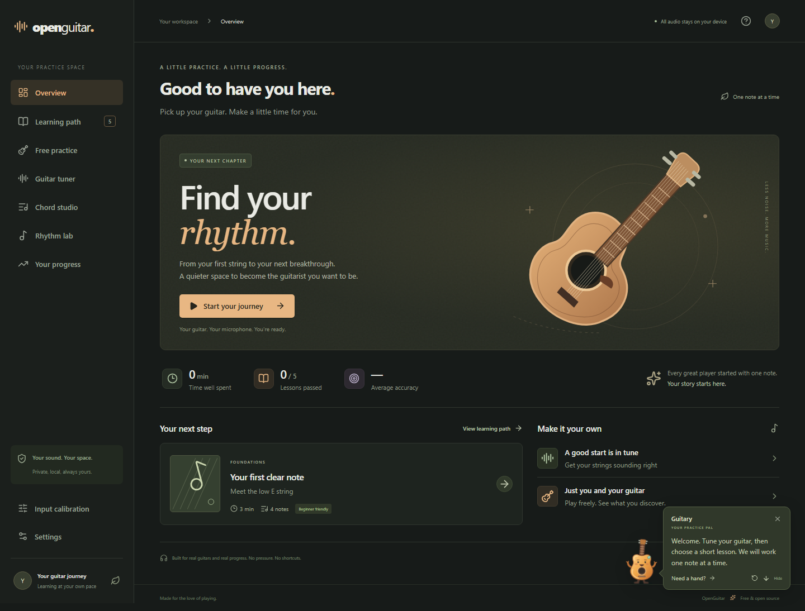

# OpenGuitar

OpenGuitar is a local-first guitar practice app built with React, TypeScript, and Vite. It provides a chromatic tuner, input calibration, five short single-note lessons, free practice, arpeggiated chord checks, rhythm exercises, and locally stored lesson results. Guitary is an original SVG guide.

Microphone capture starts only after the learner chooses to enable it. Audio is analyzed on-device and is not recorded or uploaded. The detector expects one clear note at a time; it does not transcribe chords.



## Run locally

Use Node.js 24 LTS, or a compatible Node.js 22.12+ LTS release.

```sh
npm install
npm run dev
```

Open the localhost URL printed by Vite. Browsers generally allow microphone capture on localhost and HTTPS; a deployed non-secure HTTP origin cannot use `getUserMedia`.

Useful commands:

```sh
npm run check       # typecheck, lint, unit tests, production build
npm run test:e2e    # Playwright browser checks
npm run benchmark  # deterministic synthetic detector benchmark
npm run build       # production assets in dist/
npm run preview    # serve the production build locally
```

Before the first browser-test run, install Chromium with `npx playwright install chromium`. Browser tests expect a current production build (`npm run build`); they launch development and preview servers automatically.

Both Focus and Play modes share lesson evaluation and progress. Play mode adds measured points and combos. The production build precaches its UI and DSP Worker for offline use after the first successful load. An initial offline visit before installation is not supported.

Microphone behavior still needs a physical guitar and browser check. Windows Chrome is the first manual target; passing automated checks does not establish device latency or acoustic accuracy. See [Development](DEVELOPMENT.md), [Audio engine](AUDIO_ENGINE.md), and [Roadmap](ROADMAP.md).

## Project notes

- Architecture and privacy boundaries: [ARCHITECTURE.md](ARCHITECTURE.md)
- The learning companion: [Guitary](docs/GUITARY.md)
- Android preparation and known gaps: [Android](docs/ANDROID.md)
- Frozen module interfaces: [CONTRACTS.md](docs/CONTRACTS.md)
- Initial design decision: [ADR 0001](docs/adr/0001-local-audio-and-shared-evaluation.md)
- Measured synthetic results and physical test procedure: [Performance](docs/PERFORMANCE.md)
- Public-source research and limitations: [Research](docs/RESEARCH.md)
- Verified specialist execution: [Agent architecture](docs/AGENT_ARCHITECTURE.md)
- Optional reverse-engineering tooling: [REA](docs/REA.md)

OpenGuitar is distributed under the MIT License; see [LICENSE](LICENSE).
